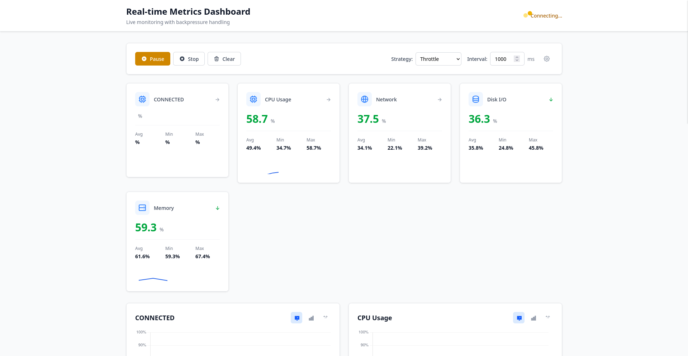

# Real-time Metrics Dashboard (realtime-dashboard)

Live system metrics (CPU, memory, network, disk) streamed over WebSocket into an Angular dashboard.

The backend in `backend/` is a small Node + `ws` server that deliberately misbehaves: it sends bursts of messages, returns random errors and sometimes drops the connection. The frontend has to stay responsive and recover on its own.



## What's in it

- **Backpressure:** the stream goes through a custom RxJS operator, and you can switch its strategy (throttle, debounce, buffer or sample) and interval from the UI. See `src/app/shared/operators/backpressure.operator.ts`.
- **Reconnect:** after a dropped connection the app retries with exponential backoff (1s, 2s, 4s… up to 30s), and gives up after 10 attempts.
- **State:** held in signals in `MetricsStore`. I left NgRx out on purpose, since a single stream doesn't need it.
- **Errors:** server errors are listed in the UI and marked as retryable or not.
- **Charts:** drawn with Chart.js. All dashboard components use `OnPush`.

Stack: Angular 21, RxJS, Signals, Tailwind, Chart.js, Node/Express, ws.

## Run

```bash
npm install && (cd backend && npm install)

cd backend && npm start   # ws://localhost:3000
npm start                 # http://localhost:4200
```

Burst, error and disconnect probabilities are set at the top of `backend/server.js`.

## TODO

- unit tests for the backpressure operator (marble tests)
- move the WebSocket URL to `environment.ts`
